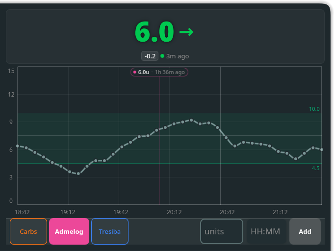
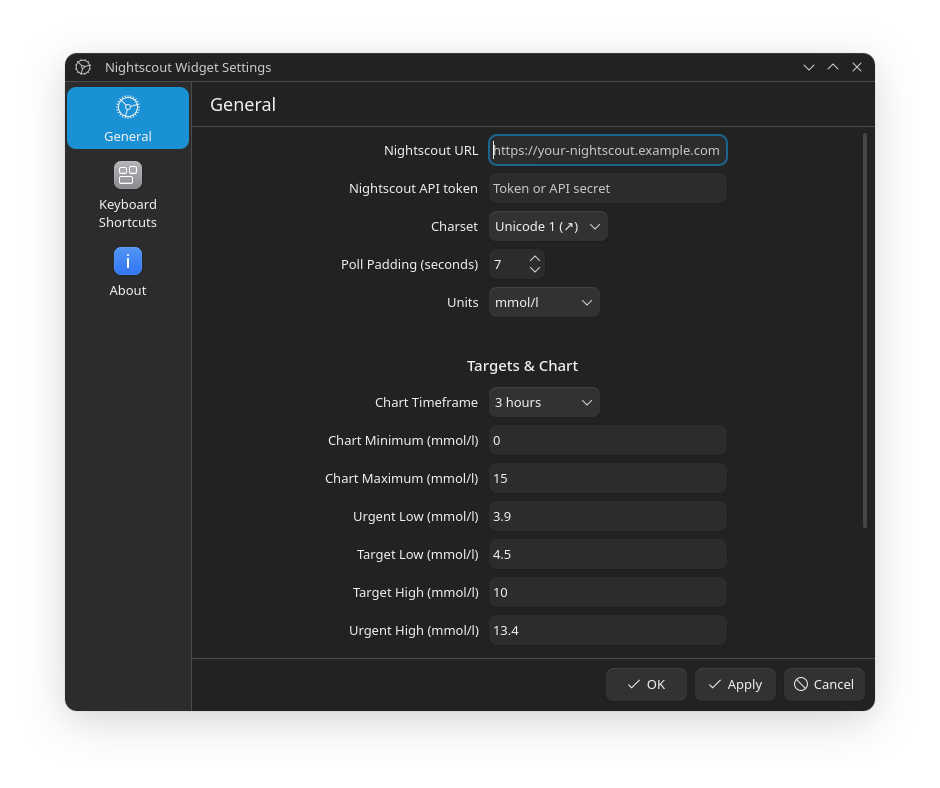

# Nightscout Widget for KDE

Plasma 6 widget made to read BG and enter treatments to Nightscout's [API](https://github.com/nightscout/cgm-remote-monitor).

The plasmoid supports both: a compact and a full mode.

* The compact representation targets panels and shows the last reading with optional units (configurable) and the trend arrow (1).
* The full representation shows a chart with readings and treatments of the last three hours in addition to the last reading and trend arrow (2).
* Treatment entry bar allows quickly adding treatments directly to Nightscout:
  * **Carbs** (Meal Bolus / Carb Correction with calculated absorption time)
  * **Admelog** (rapid-acting insulin bolus)
  * **Tresiba** (long-acting basal insulin)



## Usage

* Download the `.plasmoid` from the [GitHub releases](https://github.com/woernsn/nightscout-widget-kde/releases) or from the [KDE store](https://www.pling.com/p/2302770/).
* Configure the widget when added.
* If using the compact representation, click it to extend it to the chart view.

## Configuration



Use the KDE widget configuration to configure:

* the Nightscout server URL
* the Nightscout API token
* the charset for trend arrows
* the poll padding of the widget
* the units to be used (mg/dL or mmol/L)
* the minimum of the chart range (glucose level)
* the maximum of the chart range (glucose level)

> [!NOTE]  
> If a value in the chart is higher than the "Chart Maximum" value or lower than the "Chart Minimum" value, the chart will scale automatically and ignore the set values!

## Development & Testing

### Install or update the widget locally
```bash
kpackagetool6 -t Plasma/Applet -u src/
```

### Restart Plasma Shell (KDE Plasma 6)
In KDE Plasma 6 under systemd, restart plasmashell with:
```bash
systemctl --user restart plasma-plasmashell
```

### Run widget standalone in a test window
```bash
plasmawindowed org.kde.plasma.nightscoutwidget
```

### Run QML Unit Tests
```bash
for f in src/contents/lib/test/tst_*.qml; do
    QT_QPA_PLATFORM=offscreen /usr/lib/qt6/bin/qmltestrunner -input "$f"
done
```
